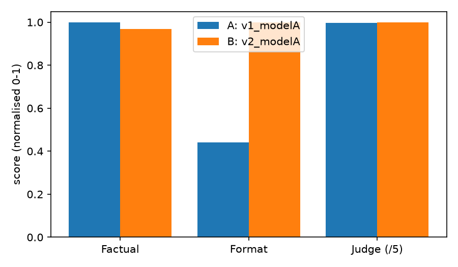

# LLM Output Evaluation Report

## 1. Setup
| | A | B |
|---|---|---|
| Run name | v1_modelA | v2_modelA |
| Model | gemini-3.1-flash-lite | gemini-3.1-flash-lite |
| Prompt version | v1 | v2 |
| Judge model | gemini-3.5-flash-lite | gemini-3.5-flash-lite |
| Prompts evaluated | 50 | 50 |

Checks: (1) factual consistency vs reference, (2) format compliance, (3) LLM-as-judge (1-5 rubric: correctness, relevance, clarity, overall).

## 2. Overall comparison
| Metric                    |   A: v1_modelA |   B: v2_modelA |   B - A |   B wins |   A wins |   Ties |   p (Wilcoxon) |
|:--------------------------|---------------:|---------------:|--------:|---------:|---------:|-------:|---------------:|
| Factual consistency (0-1) |           1    |          0.968 |  -0.032 |        0 |        3 |     47 |         0.1088 |
| Format compliance (0/1)   |           0.44 |          1     |   0.56  |       28 |        0 |     22 |         0      |
| LLM judge overall (1-5)   |           4.98 |          5     |   0.02  |        1 |        0 |     49 |         0.3173 |



## 3. Key findings
- Factual consistency (0-1): **A** is better by 0.032 (not statistically significant).
- Format compliance (0/1): **B** is better by 0.560 (statistically significant (p<0.05)).
- LLM judge overall (1-5): **B** is better by 0.020 (not statistically significant).

## 4. Breakdown by format type
| format_type   |   format_A |   format_B |   factual_A |   factual_B |   judge_A |   judge_B |
|:--------------|-----------:|-----------:|------------:|------------:|----------:|----------:|
| bullets       |        0   |          1 |           1 |        0.84 |       4.9 |         5 |
| json          |        0   |          1 |           1 |        1    |       5   |         5 |
| max_words     |        1   |          1 |           1 |        1    |       5   |         5 |
| number_only   |        1   |          1 |           1 |        1    |       5   |         5 |
| one_sentence  |        0.2 |          1 |           1 |        1    |       5   |         5 |

## 5. Largest differences (examples)
**#14** Explain the benefits of version control such as Git. (ref: `Git`)
- A (judge 4, format FAIL): Version control systems like Git are essential tools for modern software development and collaborative projects. Here are the primary benefits: * **Complete ...
- B (judge 5, format pass): - It enables seamless collaboration by allowing multiple developers to work on the same codebase simultaneously without overwriting each other's changes. - I...

**#1** What is the capital of Australia? (ref: `Canberra`)
- A (judge 5, format FAIL): ```json { "capital": "Canberra" } ```
- B (judge 5, format pass): {"answer": "Canberra", "reason": "Canberra was selected as the capital of Australia in 1908 as a compromise between rivals Sydney and Melbourne."}

**#2** What is the chemical symbol for gold? (ref: `Au`)
- A (judge 5, format FAIL): ```json { "element": "gold", "symbol": "Au" } ```
- B (judge 5, format pass): {"answer": "Au", "reason": "The symbol Au is derived from the Latin word for gold, aurum."}

**#3** Who wrote the novel 1984? (ref: `George Orwell|Orwell`)
- A (judge 5, format FAIL): ```json { "author": "George Orwell" } ```
- B (judge 5, format pass): {"answer": "George Orwell", "reason": "George Orwell is the pen name of Eric Arthur Blair, who authored the dystopian novel 1984, published in 1949."}

**#4** What is the largest planet in the solar system? (ref: `Jupiter`)
- A (judge 5, format FAIL): ```json { "largest_planet": "Jupiter" } ```
- B (judge 5, format pass): {"answer": "Jupiter", "reason": "Jupiter has the largest mass and volume of all the planets orbiting the Sun."}


## 6. Judge vs manual labels
| Measure | Value |
|---|---|
| n_samples | 20 |
| exact_agreement | 0.7 |
| within_1_agreement | 0.85 |
| mean_abs_error | 0.45 |
| judge_bias (judge_mean - manual_mean) | 0.45 |
| spearman_rho | None |
| spearman_p | None |
| cohen_kappa | 0.0 |
| cohen_kappa_quadratic_weighted | 0.0 |

Confusion matrix (rows = manual 1-5, columns = judge 1-5):

```
[0, 0, 0, 0, 0]
[0, 0, 0, 0, 0]
[0, 0, 0, 0, 3]
[0, 0, 0, 0, 3]
[0, 0, 0, 0, 14]
```

## 7. Analysis and limitations
_(Yahan apni 4-5 lines likhein: kaun sa version/model behtar raha aur kyun, judge kitna bharosemand hai, aur limitations jaise chhota test set ya judge bias.)_
